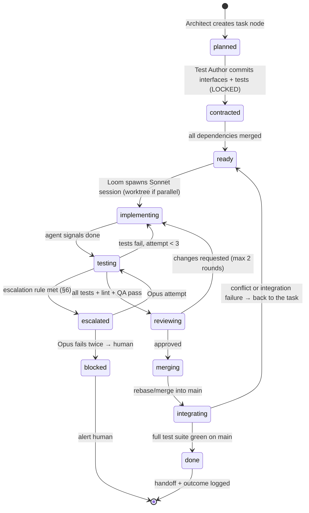
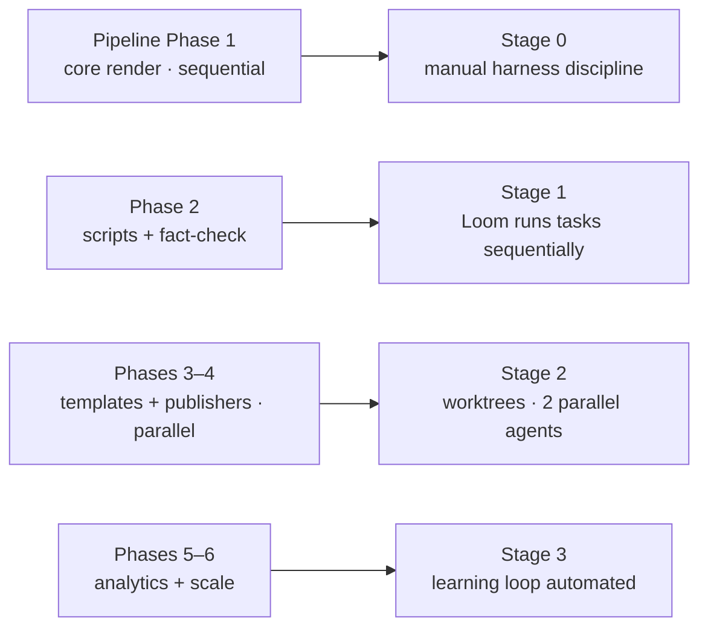
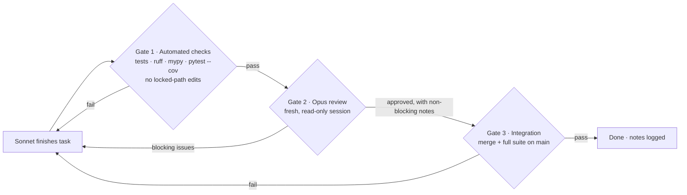

# Loom — Agent Harness for the Shorts Pipeline

> A small, deterministic harness that builds the video pipeline (see `PLAN.md`) with Claude Code agents. It grows in stages, **driven by evidence from its own task logs**, so you only build what's needed.
>
> Renamed from "Fable" to avoid confusion with the Claude Fable model in logs and prompts.

---

## 1. Vision (fitted to this project)

Loom is a **deterministic orchestrator** (plain Python, no LLM in the control flow) that runs Claude Code sessions headlessly over a **task dependency graph** stored in the repo. Every task gets a fresh, stateless session with a clearly scoped context. Agents write code against **contracts and tests frozen before implementation starts**, in isolated Git worktrees when tasks run in parallel. Every task's result is logged in a structured file, and a weekly **retrospective loop** turns repeated failures into concrete improvements to prompts, CLAUDE.md rules and skills, then checks whether they helped.

It's built in four stages that line up with the pipeline phases. Phase 1 of the pipeline is mostly sequential, so parallel worktrees only arrive when the work actually branches (Phases 3–4).

---

## 2. Principles

1. **Code decides, models do the work.** The orchestrator owns control flow, retries, escalation and merging. Models never choose what runs next.
2. **One task = one fresh session.** No long-running agents. Context passes between sessions only through `handoff.md` and the repo.
3. **Contracts before code.** Interfaces, schemas and tests are committed and **locked** before implementation fans out. Implementers can't edit locked tests.
4. **Whoever did the work writes the handoff.** The implementer writes the handoff from a fixed template before its session ends; a cheaper model may tidy the format but never writes the content.
5. **Log everything, improve from evidence.** Every task produces an outcome record. No changes to prompts or rules without data behind them.
6. **Small concurrency.** At most 2 implementer sessions at once, to stay within plan usage limits.
7. **Add complexity only when there's evidence for it.** No knowledge graph, no extra roles, until the logs show they're needed.

---

## 2a. What's Automated vs. What Needs You

| Step | Stage 0 (Phase 1) | Stage 1+ (Phase 2 onward) |
|---|---|---|
| Breaking work into tasks | You run an Opus session | **Automatic** (Architect) |
| Writing + locking tests | You run an Opus session | **Automatic** (Test Author) |
| Approving contracts/tests | **You** (merge PR) | **You** (merge PR), once per batch of tasks |
| Implementing tasks | You start Sonnet sessions | **Automatic** |
| Test → fix loops, retries, escalation | Manual | **Automatic** |
| **Per-task review** | You run an Opus review session | **Automatic**, after every task (§6a) |
| Merging + integration tests | Manual | **Automatic** |
| Handoffs + outcome log | Agent writes the handoff; you log | **Automatic** |
| Retrospective changes | — | Proposed automatically; **you** merge the PR |
| Blocked tasks | — | **You**, only when Opus has failed twice |

From Stage 1, your job is: **approve contracts per batch, approve retrospective PRs, and handle the rare blocked task.** Everything between those checkpoints runs on its own.

---

## 3. Roles & Model Routing

| Role | Model | Why this model | Runs when |
|---|---|---|---|
| **Architect** | **Claude Opus 5.5** (`claude-opus-5-5`) | Breaking requirements into tasks and writing interfaces/tests sets the quality of everything after it, so the most capable everyday model goes here | Start of each pipeline phase; re-plans after escalations |
| **Contract & Test Author** | **Claude Opus 5.5** | Tests are the definition of done; weak tests let weak code through | Before a batch of tasks fans out |
| **Implementer** | **Claude Sonnet 5.5** (`claude-sonnet-5-5`) | Best balance of coding quality, speed and usage cost for scoped tasks with clear tests | Each implementation task, inside its worktree |
| **Escalation Engineer** | **Claude Opus 5.5** | Takes over a task after the implementer gets stuck (see §6), with the full failure history | On escalation |
| **Reviewer** | **Claude Opus 5.5**, read-only, fresh context | Independent review catches what the author missed; read-only so it can't "fix" its way into approval. A different model from the implementer, so it doesn't share Sonnet's blind spots | **After every task**, before that task merges (§6a). Never batched to the end |
| **Scribe** | **Claude Haiku 5.5** (`claude-haiku-5-5`) | Mechanical, high-volume, low-risk work: formatting handoffs, updating README/docstrings from diffs, sorting outcome-log entries into failure categories, writing the weekly digest | After merges; nightly/weekly |
| **Retrospective Analyst** | **Claude Opus 5.5** | Spots patterns in failure logs and proposes rule/prompt/skill changes | Weekly, or every 10 completed tasks |

**Claude Fable 5.2:** deliberately not in the routing. The work isn't hard enough to justify it, and it would use up plan limits quickly. If your plan includes it, keep it as a manual break-glass option for a task that fails even after Opus escalation. Never route to it automatically.

**Rule:** routing lives in `.harness/config.yaml`, so the retrospective can propose changes like "move test-writing for render tasks to Sonnet". Every change is logged and measured.

---

## 4. Task Lifecycle



### Pipeline Phase → Harness Stage



---

## 5. Contracts-First Workflow

Before any batch of tasks fans out:

1. **Architect** writes the task graph for the phase: `.harness/tasks/<phase>/*.yaml` (see §8).
2. **Test Author** commits, in one PR to `main`:
   - interface stubs (`Protocol`/ABC classes, Pydantic schemas) with docstrings
   - tests per task: unit tests plus one acceptance test that defines "done"
   - marks the test files as locked in `.harness/locks.yaml`
3. **You** review and merge that PR. This is the main human checkpoint: approve the contracts and the rest follows.
4. **Lock enforcement:** a Claude Code `PreToolUse` hook in every implementer session blocks Edit/Write on locked paths and returns a message telling the agent to request a contract change instead.
5. **Contract change requests:** an implementer that believes a test is wrong writes `CONTRACT_CHANGE.md` in its worktree and stops. Loom sends it to the Architect (Opus), who approves or rejects it, and you get notified.

---

## 6. Escalation Rules

Counted per task, by Loom, from test output (not from the agent's own report):

| Condition | Action |
|---|---|
| Same test(s) failing 3 attempts in a row with no fewer failures | Escalate to Opus |
| 5 attempts total, even if failures keep changing | Escalate to Opus |
| Agent edits locked files / gets blocked by the hook 2× | Stop, send to Architect as a likely contract problem |
| Session hits its turn limit or the context threshold (§7a) | Rotate: new session, same model, with handoff. **Does not count as an attempt** (running long ≠ failing) |
| Same task rotated **3 times** for turn/context limits | Stop. Send to Architect to **split the task** into smaller tasks; the partial work on the branch is kept as the starting point |
| Opus fails 2 attempts | Mark `blocked`, alert human |
| Reviewer requests changes 2× | Escalate to Opus for the fix, Reviewer re-reviews |

"Progress" means the set of failing tests is shrinking. Different failures each time don't count as being stuck.

---

## 6a. Per-Task Review Gate (no pile-up at the end)

Every Sonnet task passes **three gates in order** before it can merge. Problems are caught in the task that created them, while the context is small and the fix is cheap.



**Gate 1, automated checks (free, instant):** tests, lint (`ruff`), types (`mypy --strict` on `pipeline/`), coverage must not drop, hook confirms no locked/out-of-scope edits. Opus usage is never spent on code that doesn't even pass these.

**Gate 2, Opus review:** the reviewer gets *only* the task YAML, the contract/tests, the diff, the implementer's handoff and the relevant `PLAN.md` section. It reviews against a fixed checklist:

1. **Meets the contract:** does the code do what the task and PLAN.md say, not just pass the tests?
2. **Test integrity:** did the code pass by special-casing test inputs? Any test gaming?
3. **Edge cases:** empty/long inputs, unicode in captions, odd audio lengths, API errors, timeouts.
4. **Failure handling:** errors are caught, logged and surfaced; nothing is silently swallowed; the pipeline degrades gracefully.
5. **Security:** no secrets in code/logs, no shell injection in FFmpeg/subprocess calls, no unpinned or untrusted dependencies.
6. **Fit with the codebase:** follows existing interfaces and CLAUDE.md rules; no duplicate helpers; no scope creep outside `paths_allowed`.
7. **Maintainability:** clear names, no dead code, docstrings on public interfaces.

The output is structured, so Loom can act on it without interpretation:

```json
{"verdict": "approve | changes_requested",
 "blocking": [{"file": "...", "line": 0, "issue": "...", "fix_hint": "..."}],
 "non_blocking": [{"file": "...", "issue": "..."}],
 "checklist": {"contract": "pass", "test_integrity": "pass", "edge_cases": "fail", "...": "..."}}
```

- **Blocking** issues go back to Sonnet as the next attempt's input. Max 2 review rounds, then Opus fixes it (§6).
- **Non-blocking** notes are logged to `.harness/log/review_notes.jsonl`. Haiku groups them weekly; the retrospective turns recurring notes into CLAUDE.md rules, so the same issue stops coming back.

**Gate 3, integration:** merge into main, run the full suite. This catches problems between tasks that a single-task review can't see.

**Phase-end check (lightweight):** when a whole phase is done, one Opus session reviews the phase's *combined* architecture: interfaces fitting together, duplicated logic across tasks. Since every task was already reviewed, this is a short pass, not a 100-issue audit.

---

## 6b. Specialist Reviews (QA, Security, CSO, Audit, "Frontend")

**Principle:** free deterministic tools first (fast, no false confidence, no usage), then **targeted** LLM reviewers triggered by *what changed*, not every reviewer on every task. Running every review on every task would burn the usage limits and drown real findings in noise.

### The review layers

| Review | What it checks | When | Deterministic tools (free, run in Gate 1 / CI) | LLM reviewer | Human |
|---|---|---|---|---|---|
| **Code review** | Correctness, contract fit, maintainability | **Every task** | ruff, mypy, pytest, coverage | Opus, Gate 2 checklist (§6a) | — |
| **QA review** | Test quality, not just test passing: missing edge cases, weak assertions, flaky tests | Every task (light, part of Gate 2) + **end of each phase** (deep) | pytest-cov, **hypothesis** (property tests for caption timing, number normalisation), **mutmut** mutation testing per phase (shows which tests would miss a bug) | Opus "QA Lead": reads the mutation report + coverage gaps → writes missing tests as a new locked-test task | — |
| **Security review** | Code-level vulnerabilities | Every task (tools) + **path-triggered** reviewer | **bandit** (Python SAST), **semgrep** OSS rules, **gitleaks** (secrets), **pip-audit** (vulnerable deps), **actionlint** (workflow mistakes) | Opus "Security Reviewer", triggered when a task touches `publish/`, `ingest/`, auth/OAuth, `subprocess`/FFmpeg calls, or `.github/workflows/` | — |
| **CSO review** | Overall security posture: threat model, what an attacker could do with the system | **End of each phase** + whenever a new external integration is added | — | Opus "CSO": STRIDE threat model of the whole pipeline, updates `docs/threat-model.md`, opens tasks for each real risk | **You sign off** before first public publishing |
| **Audit** | Compliance & hygiene: licences, platform policies, secret handling, permissions | **Weekly (scheduled)** + before go-live | **pip-licenses** (dependency licences), asset licence log check, scheduled pip-audit, GitHub token-permission lint | Opus "Auditor" (per phase): platform-policy checklist (YouTube inauthentic content, AI disclosure, TikTok/IG terms), OAuth scopes are the minimum needed, data retention | **You approve** the audit report |
| **"Frontend" review** | This product's frontend is **the video itself** (and later the agent office) | Every task touching `render/` or `visuals/` | Golden-render tests: render the sample scripts, check duration, resolution, caption timing, safe zones; extract frames at fixed timestamps | Opus with **image input**: reviews extracted frames for caption readability, safe-zone overlap, contrast, visual glitches | Spot-check videos weekly |
| **Office/dashboard UI** (if built) | Web UI quality | When the office code changes | Playwright screenshot tests, axe accessibility checks | Sonnet reviews screenshots | — |

### Threats specific to this project (seed for the CSO review)
- **Prompt injection via ingested content:** RSS/news text goes into Gemini prompts. A malicious article could inject instructions ("include this link…") into a script that gets **published publicly**. Mitigations: treat source text as data (delimited, never as instructions), the fact-check gate, a link/URL allowlist in descriptions, human PR review.
- **OAuth token theft:** refresh tokens publish to your channels. Store them only in GitHub Secrets, use minimum scopes, never `pull_request_target` with secrets, pin third-party Actions by commit SHA, keep the `GITHUB_TOKEN` permissions minimal per workflow.
- **Supply chain:** pinned dependencies + pip-audit; Dependabot alerts (available on private repos).
- **Command injection:** FFmpeg filter strings built from script text (captions!) must be escaped or passed via files, never interpolated into shell commands.
- **Account bans:** rate/volume limits respected; no unofficial upload methods.

> Note: GitHub's own CodeQL code scanning and secret scanning are free on **public** repos but need a paid add-on for private ones, so this plan uses bandit/semgrep/gitleaks in Actions instead. They're free in private repos.

### How it's wired
- **Gate 1** runs all deterministic tools on every task (`make check`). Any high-severity finding = Gate 1 fail.
- **Path triggers** in `.harness/config.yaml`:
  ```yaml
  specialist_reviews:
    security: ["pipeline/publish/**", "pipeline/ingest/**", "**/auth*", ".github/workflows/**", "pipeline/render/compose.py"]
    visual_qa: ["pipeline/render/**", "pipeline/visuals/**", "assets/**"]
  ```
  Matching tasks get the specialist review **in addition to** the normal Gate 2 review, run in parallel.
- **Phase-end reviews** (QA Lead, CSO, Auditor) become tasks in the task graph automatically when the last task of a phase merges. Their findings become **new tasks**, not direct edits.
- **Scheduled audit** runs as a GitHub Actions workflow (weekly), so it runs with your PC off. It opens an issue if anything is found.
- **All LLM reviewers must give evidence:** file:line, severity (critical/high/medium/low), a concrete exploit/failure scenario, and a fix hint. Findings without a scenario are logged as notes, not blockers. This keeps false positives from piling up.
- Each reviewer role gets its own file in `.claude/agents/` (`security-reviewer.md`, `qa-lead.md`, `cso.md`, `auditor.md`, `visual-qa.md`), all **Opus 5.5, read-only tools**.

### What stays human (on purpose)
- Signing off the threat model and audit before **first public publishing**: these tokens can post to your accounts.
- Accepting platform-policy risk (that's a judgement about your channel, not code).
- Everything else runs automatically and only reaches you as approved/rejected PRs, issues, or alerts.

---

## 7. Handoff Template (`handoff.md`)

Written by **the implementer** as its final step (enforced: Loom rejects the task as done if the file is missing or has empty required sections). Haiku may reformat it, not rewrite it.

```markdown
# Handoff — <task-id>
## Goal
<one sentence>
## Status
done | partial | blocked
## What changed
- <file>: <why, not just what>
## Decisions made (and why)
- ...
## Tried and abandoned
- <approach> — <why it failed>   ← REQUIRED, write "none" if none
## Known risks / fragile spots
- ...
## Next step for whoever picks this up
- ...
## Evidence
- tests: <passed/failed counts>   - commands run: <...>
```

---

## 7a. Session Rotation & Handover Mechanics

**How sessions end:** Loom runs every step headless with `claude -p "<prompt>" --model <model> --output-format json --max-turns <n>`. The process **exits on its own** when Claude finishes its reply; Loom never kills a working session (except `stop --now`). After each exit Loom reads the JSON result (`session_id`, `usage`, turns, result) and makes one decision: **resume** the same session (`--resume <session_id>`) or **rotate** to a fresh one.

### Resume vs. rotate rules

| Situation | Decision | Why |
|---|---|---|
| Tests failed, attempt limit not reached | **Resume** | Failure output and recent attempts are useful context |
| Reviewer requested changes | **Resume** implementer session, findings as next message | It knows the code it just wrote |
| Task passed all three gates | **Rotate** (end → handoff) | One task = one session |
| Context usage > **60%** of the model's context window (from `usage`) | **Rotate** mid-task (partial handoff → fresh session, same task) | Prevents context bloat |
| `max_turns` reached | **Rotate** mid-task | Same. Neither this nor the context rotation counts as an attempt; after 3 such rotations the task goes to the Architect to be split (§6) |
| Escalation to Opus | **Rotate** (new model, fresh session) | Clean view: handoff + full failure history |
| `loom pause` / `stop` | **Rotate** with status `partial` | So `loom resume` can continue |

Thresholds live in `.harness/config.yaml` (`rotate_context_pct: 60`) so the retrospective can tune them from evidence.

### Handover steps (every rotation)

1. **Request:** Loom resumes the ending session once: *"Stop working. Write `.harness/handoffs/<task-id>.md` using the template in HARNESS.md §7. Status: done | partial."*
2. **Validate:** the file exists, all required sections are present and non-empty, "Tried and abandoned" is filled in ("none" is allowed), and the Evidence section matches Loom's own test results.
   - Fails → resume once with the list of missing or incorrect sections.
   - Fails again → **Haiku** writes a minimal handoff from `git diff` + test output, marked `generated_by: fallback`, and the outcome log records `handoff_quality: fallback` (a signal for the retrospective).
3. **Commit:** code + handoff on the task branch (`WIP:` prefix if partial).
4. **Assemble the next session's prompt**, nothing else carried over:
   - the task YAML (goal, `paths_allowed`, tests, acceptance)
   - the latest handoff for this task (and the dependency tasks' handoffs, if listed in `context_files`)
   - the files in `context_files` (Stage 2+: plus import-graph neighbours)
   - for retries/escalations: the last test failure output and any blocking review findings
   - a fixed preamble: "You are the <role>. Follow CLAUDE.md. Start by reading the handoff."
5. **Log:** outcome record with `rotation_reason` (`task_done | context_limit | max_turns | escalation | pause`) and the context % at rotation.

### Context layers (summary)
1. **Small start:** sessions begin with only the task, handoff, `context_files` and recent failures.
2. **Hygiene:** the §7b rules keep tool output from flooding the context.
3. **Rotation at 60%:** a structured, validated handoff, then a fresh session.
4. **Claude Code auto-compact:** left on as the last resort only, for a single step that overshoots. Rotation should normally happen first; the outcome log records `auto_compacted: true` if it didn't, so the retrospective can lower the threshold.

### Stage 0 (manual) equivalent
- Task done → ask for the handoff → `/clear` or a new window for the next task.
- Run `/context` periodically. Above ~50% on an unfinished task → ask for a partial handoff and start a fresh session from it, rather than letting the conversation auto-compact.

---

## 7b. Context Hygiene Rules (go into CLAUDE.md)

Most context bloat comes from tool output, not code. Every session follows these:

- **Tests:** `pytest -q --tb=short`; run single test files/IDs while iterating, the full suite only before signalling done.
- **FFmpeg / subprocess:** `-hide_banner -loglevel error`; long logs go to `out/logs/<step>.log`, then search the log instead of printing it.
- **Reading files:** search first (`grep -n`), then read only the relevant line ranges. Never read whole large or generated files.
- **Never print:** whole JSON queues, `.ass` caption files, transcripts, binary/media data, `pip`/`npm` install logs (use `-q`).
- **Exploration:** use a sub-agent for wide searches ("where is X used?"), so only its conclusion lands in the main session.
- **Diffs:** `git diff --stat` first, full diff only for the files you need.
- **Package installs / environment debugging:** if it takes more than 2 tries, stop and write `ENV_ISSUE.md` instead of looping. Loom routes it as an `env_or_dependency` failure.

The retrospective can add rules here when the outcome log shows a pattern of context-limit rotations.

---

## 8. Task Node Format

```yaml
# .harness/tasks/phase1/captions_ass.yaml
id: p1-captions-ass
title: Build word-by-word .ass caption generator
depends_on: [p1-schema, p1-align]
role: implementer           # → model via config.yaml
paths_allowed:              # agent may only edit these
  - pipeline/render/captions_ass.py
  - assets/fonts/**
tests:
  - tests/render/test_captions_ass.py
acceptance: tests/render/test_captions_ass.py::test_acceptance
context_files:              # what the session reads first; no knowledge graph needed
  - PLAN.md#5
  - pipeline/voice/align.py
  - .harness/handoffs/p1-align.md
max_turns: 40
```

`paths_allowed` is also enforced by the hook. This keeps parallel worktrees out of each other's files and catches most merge conflicts before they happen.

---

## 9. Outcome Log & Learning Loop

### Outcome record (one JSON line per task attempt → `.harness/log/outcomes.jsonl`)

```json
{
  "task_id": "p1-captions-ass", "attempt": 2, "role": "implementer",
  "model": "claude-sonnet-5-5", "started": "...", "duration_s": 412,
  "turns": 23, "usage": {"input_tokens": 0, "output_tokens": 0},
  "result": "tests_failed", "failing_tests": ["test_safe_zone"],
  "escalated": false, "review_findings": [], "lock_violations": 0,
  "failure_category": null
}
```

`failure_category` is filled in by Haiku from a fixed list: `wrong_api_usage`, `env_or_dependency`, `spec_misread`, `flaky_test`, `ffmpeg_syntax`, `contract_wrong`, `other`.

### The loop (weekly, or every 10 completed tasks)

1. **Measure:** Loom computes per-category failure rates, first-attempt pass rate, escalation rate and review rejection rate.
2. **Diagnose:** the Retrospective Analyst (Opus) reads the outcomes and handoffs ("Tried and abandoned" sections are the most valuable input) and proposes **at most 3 changes**, each one of:
   - a CLAUDE.md rule (e.g. "always use `-filter_complex` with labelled pads; see `docs/ffmpeg.md`")
   - a new or updated skill (e.g. `.claude/skills/ffmpeg-ass/`)
   - a prompt/template edit for a role
   - a routing change in `config.yaml`
3. **Approve:** proposals arrive as a PR. You merge or reject.
4. **Verify:** each merged change is tagged in the log. After the next N tasks, Loom compares the metric it was meant to improve. If it didn't improve, the next retrospective proposes reverting it.

This is how the harness gets better: changes come from evidence, are applied as small reversible PRs, and are checked afterwards.

---

## 10. Build Stages

### Stage 0 — Manual discipline (during pipeline Phase 1)
No orchestrator code yet. You run Claude Code by hand, following the harness rules:
- task files in `.harness/tasks/phase1/`, worked one per fresh session
- tests written and locked first (Opus session), implementation in Sonnet sessions (`/model`)
- implementer writes `handoff.md` from the template
- **you** append an outcome line per task (a 10-line `log_outcome.py` helper)
- install the lock/paths `PreToolUse` hook now; it's cheap and catches problems immediately

**Exit when:** Phase 1 is done and you have ~10–15 outcome records.

### Stage 1 — Sequential orchestrator (pipeline Phase 2)
- `loom run` reads the task graph, picks the next ready task, and runs `claude -p` headless with the task's role/model, context files and allowed tools
- runs the tests itself, counts attempts, applies the escalation rules, writes outcome records automatically
- Opus review runs in a separate read-only session (Edit/Write tools disabled)
- notifications through the pipeline's existing alert channel

**Exit when:** a whole phase completes with only contract approval and final merges done by you.

### Stage 2 — Parallel worktrees (pipeline Phases 3–4)
- `git worktree` per task when ≥ 2 tasks are ready with no overlapping `paths_allowed`
- concurrency limit 2; merge queue processes one merge at a time; integration test suite after each merge
- conflict → task goes back to `ready`, rebased onto the new main, with the conflict in its context

**Exit when:** parallel runs finish faster than sequential ones *and* the integration failure rate stays below ~10%.

### Stage 3 — Automated learning loop (pipeline Phases 5–6)
- metrics computation, Haiku categorisation and the Opus retrospective run on a schedule
- before/after tracking for every applied change
- optional: a knowledge graph or codebase index, **only if** the logs show `spec_misread` or "couldn't find X" failures are common

---

## 10a. Pause, Stop & Resume (safe to turn the PC off)

**Rule:** all harness state lives in files in the repo (task states, handoffs, outcome log, worktree branches), never only in memory. So stopping Loom at any point loses at most the current attempt, and `loom resume` continues where it stopped.

> The **production pipeline** (GitHub Actions) is unaffected by any of this: it runs in the cloud whether your PC is on or off. Loom only runs while you're developing.

### Commands

| Command | What happens | Use when |
|---|---|---|
| `loom pause` | **Drain mode:** running tasks finish their current attempt (tests run, handoff written, WIP committed), no new tasks start, then Loom exits. Also triggered by creating the file `.harness/PAUSE`. | Normal shutdown. Takes a few minutes |
| `Ctrl+C` once | Same as `loom pause` | Same |
| `Ctrl+C` twice / `loom stop --now` | **Immediate stop:** sends interrupt to all Claude Code sessions, waits ≤ 30 s, then kills them. Each interrupted task: uncommitted changes saved as a `WIP: interrupted` commit on its task branch, state set back to `ready`, **attempt not counted** toward escalation | You need to shut down right now |
| `loom status` | Shows running/queued/blocked tasks and whether a pause is pending | Before shutting down |
| `loom resume` | Removes `.harness/PAUSE`, checks `limit_state.json` (§10b), checks for stale state (tasks marked running with no live process → reset to `ready`), then continues the graph. Interrupted tasks start a fresh session from their branch + last handoff | Next time you're at your PC |

### Crash / power-loss safety
- Loom writes a heartbeat and its PID to `.harness/loom.lock`. On start, a lock with a dead PID means the last run crashed → automatic stale-state recovery (same as `resume`).
- Task state changes are written atomically (write temp file → rename), so a power cut never leaves half-written state.
- Worktrees survive reboots; `git worktree prune` runs on resume to clean up any that were deleted.

### Stage 0 (manual sessions) equivalent
1. Let the current task reach a stopping point, or press `Esc` to interrupt Claude.
2. Ask the session: "Stop here. Write handoff.md for this task (status: partial) and commit WIP."
3. Close the window and turn the PC off.
4. Next time: start a **fresh** session and point it at the task YAML + handoff. Use `claude --continue` only if the task was nearly finished.

---

## 10b. Usage Limits (5-hour and weekly) — Wait, Then Auto-Resume

The plan's usage limits are an expected event, not an error. When one is hit, Loom **freezes cleanly, records the reset time, waits, checks the limit has lifted, then continues exactly where it stopped**.

### Detection
- After every headless call Loom checks the exit code + output for a usage-limit response.
- **Don't hard-code the message format.** During Stage 0, save the real limit messages you get (5-hour and weekly) to `tests/fixtures/limit_messages/` and build the parser from those fixtures. The parser extracts:
  - `limit_type`: `session_5h | weekly | unknown`
  - `reset_at`: absolute timestamp (UTC) if the message contains one
  - `model`: which model hit it (some plans limit models separately)
- If no reset time can be parsed → `reset_at = unknown`, use probing (below).

### What happens at the moment of the limit
1. **No new sessions start.** The limit applies to every agent, so all parallel tasks go into `waiting_limit` together.
2. The interrupted step's work is committed as `WIP: usage limit` on its task branch.
3. **No handoff is requested**, since the model can't be called. Instead the **session ID is saved**, because the session's context is still valid and can simply be resumed after the reset.
4. **No attempt counted** and no escalation. Hitting a limit isn't a failure.
5. Write `.harness/limit_state.json`:
   ```json
   {"limit_type": "weekly", "model": "claude-opus-5-5", "hit_at": "2026-11-15T21:04:00Z",
    "reset_at": "2026-11-18T09:00:00Z", "source": "parsed | estimated",
    "waiting_tasks": [{"task_id": "p3-yt-publish", "session_id": "…", "context_pct": 34}]}
   ```
6. Log an outcome record (`result: usage_limit`) and send an alert: *"Hit weekly limit. Resuming at Wed 09:00 (local)."*

### Waiting & resuming
- **Wait until `reset_at` + 2 minutes** (buffer for clock drift).
- **Probe before resuming:** one tiny call (`claude -p "reply OK" --model claude-haiku-5-5 --max-turns 1`, or the model that was limited). If it's still limited → back off: 15 min → 30 min → 60 min (max 60).
- **Unknown reset time:** probe on the same backoff schedule from the start.
- **Probe passes → resume:**
  - each waiting task **resumes its saved session** (`--resume <session_id>`) with *"Usage limit reset; continue the task."* Its context is intact, so no handoff is needed.
  - if that session was already above the context threshold, or the resume fails → normal rotation (§7a): fresh session from the latest handoff + branch.
- Delete `limit_state.json`, alert *"Resumed after limit reset."*

### If the PC is off or asleep at reset time
- `loom resume` (and Loom start-up) always checks `limit_state.json` first: if the reset time has passed → probe → resume; if not → keep waiting.
- **Optional auto-wake:** when a limit is hit, Loom registers a one-time **Windows Task Scheduler** job for `reset_at + 2 min` that runs `loom resume`, with *"Wake the computer to run this task"* enabled. This works from **sleep/hibernate, not a full shutdown**. The job is deleted after it runs or if you resume manually.

### Avoiding hitting limits mid-task (Stage 3 refinement)
- The outcome log records usage per task, so Loom learns roughly how much a typical task uses.
- Near a known limit (e.g. the last ~10% of the observed budget), Loom **finishes running tasks but doesn't start new big ones**, so limits tend to land between tasks rather than mid-step.
- **Per-model limits:** if only one model is limited (e.g. Opus weekly) and another isn't, Loom can keep running tasks for the available model. Roles are **never silently swapped to a weaker model.** Opus-only work (review, escalation) waits, so the review gate is never skipped. Any fallback routing must be set explicitly in `config.yaml`.

### Office / dashboard
- Characters show **"on break"** with a countdown to `reset_at`; the status bar shows which limit was hit and when work resumes.

---

## 11. Repo Layout

```
shorts-pipeline/
├── PLAN.md                         # the product plan
├── HARNESS.md                      # this file
├── CLAUDE.md                       # rules every session loads (grows via retrospectives)
├── .claude/
│   ├── settings.json               # hooks registration
│   ├── hooks/enforce_locks.py      # blocks locked paths + paths outside paths_allowed
│   ├── agents/                     # role definitions with model frontmatter
│   │   ├── architect.md            # model: opus
│   │   ├── implementer.md          # model: sonnet
│   │   ├── reviewer.md             # model: opus, read-only tools
│   │   └── scribe.md               # model: haiku
│   └── skills/                     # created by retrospectives
├── .harness/
│   ├── config.yaml                 # role → model, limits, concurrency
│   ├── locks.yaml
│   ├── tasks/<phase>/*.yaml
│   ├── handoffs/<task-id>.md
│   ├── log/outcomes.jsonl
│   ├── retros/<date>.md
│   └── loom/                       # orchestrator code (Stage 1+)
├── pipeline/ ...                   # the product (PLAN.md §9)
└── tests/ ...
```

---

## 12. Deliberately Out of Scope (for now)

| Idea | Why not yet | Add it when |
|---|---|---|
| Codebase knowledge graph | Small new repo; grep + `context_files` are enough and don't go stale | Logs show frequent "couldn't find" / `spec_misread` failures |
| More than 2 parallel agents | Plan usage limits; agents stuck waiting on limits cancel out the parallelism | Measured rate-limit headroom |
| LLM-driven orchestration | Non-deterministic, hard to debug | Never for control flow |
| Haiku retrieving context | Choosing context files is a judgement call; the Architect sets it per task | Retrospective shows Architect-chosen context is often wrong |
| Fable 5.2 in automatic routing | Usage cost; tasks don't need it | Opus escalations frequently end `blocked` |
