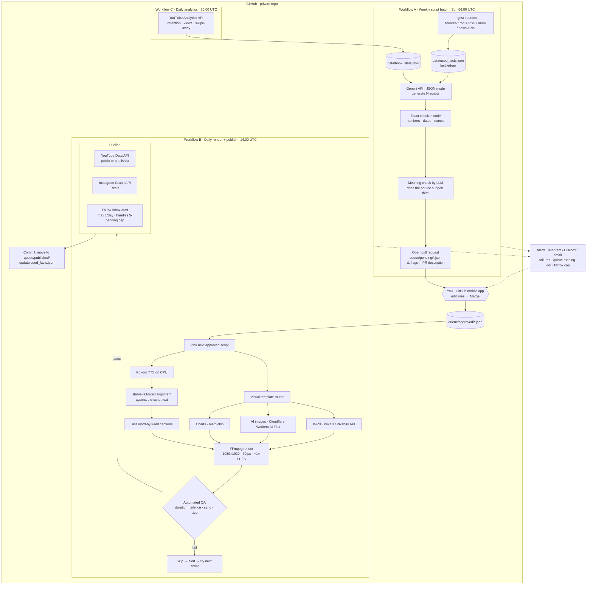

# $0 Automated Faceless Short-Form Video Pipeline — v3 (Cloud-Only)

> **Changes since v2**
> - **Runs entirely in the cloud.** No local PC, GPU or Raspberry Pi. Videos are made and published with your computer off.
> - **Scripts are approved in batches through a GitHub pull request** on your phone, instead of approving every video in a chat bot.
> - **Fact-check never stops the run.** Numbers, dates and names are checked exactly in code; the wording is checked for meaning by an LLM. Anything uncertain gets flagged in the PR instead.
> - **Captions use forced alignment** against the script text, not plain transcription.
> - **TikTok's 5-pending-drafts limit** is handled by sending one draft a day.
> - **Vacation mode:** approve weeks of scripts in advance; YouTube and Instagram publish on their own.
> - **Kokoro is the only voice** (2026-11-15). edge-tts was dropped: it is an unofficial endpoint and may be blocked from cloud IPs.

---

## 1. Executive Summary

A free pipeline that **researches, scripts, voices, renders and publishes** short-form videos (YouTube Shorts, Instagram Reels, TikTok). Everything runs on **GitHub Actions** (scheduling and compute), **free cloud APIs** (Gemini for scripts, Cloudflare Workers AI for images) and **open-source CPU tools** (Kokoro, stable-ts, FFmpeg).

**Human input:** about 15 minutes a week to review and merge a pull request of scripts on the GitHub mobile app. Before a vacation, merge 2–4 weeks of scripts at once.

**How automatic each platform is (at $0):**

| Platform | Fully automatic? | Requirement |
|---|---|---|
| YouTube Shorts | ✅ Yes | Google API project must pass the YouTube API compliance audit. Until then, uploads are locked to private. **Apply in week 1.** |
| Instagram Reels | ✅ Yes | Instagram Business/Creator account linked to a Facebook Page; Graph API content publishing |
| TikTok | ⚠️ One tap per video | Unaudited API apps can only post privately or send drafts to the inbox, and TikTok's audit is meant for apps serving a wide audience, not personal pipelines. The pipeline sends one draft a day; you tap **Post** in the app (~10 s). On vacation, tap from your phone or let TikTok pause. |

---

## 2. Architecture



### ASCII version

```
┌──────────────────────────── GitHub (private repo) ────────────────────────────┐
│                                                                               │
│  [A] WEEKLY (Sun)                                                             │
│   sources/ + RSS/APIs ─► fact ledger ─► Gemini writes 7 scripts               │
│        ─► exact check (numbers/dates/names) ─► meaning check (LLM)            │
│        ─► opens Pull Request  (⚠️ flags listed in the PR)                     │
│                                   │                                           │
│                    YOU: review/edit on GitHub app ─► MERGE                    │
│                                   │                                           │
│                                   ▼                                           │
│                         queue/approved/*.json                                 │
│                                   │                                           │
│  [B] DAILY                        ▼                                           │
│   next script ─► Kokoro TTS ─► stable-ts align ─► .ass captions ──────┐       │
│              └─► visuals: charts / Cloudflare Flux / Pexels ──────────┤       │
│                                                                       ▼       │
│                                              FFmpeg render ─► QA gate         │
│                                                                   │           │
│                           ┌───────────────────┬───────────────────┤           │
│                           ▼                   ▼                   ▼           │
│                       YouTube            Instagram          TikTok draft      │
│                       (auto)              (auto)           (tap to post)      │
│                                                                   │           │
│                         commit ledger + move to queue/published/  │           │
│                                                                               │
│  [C] DAILY analytics ─► hook_stats.json ─► feeds next week's scripts          │
└───────────────────────────────────────────────────────────────────────────────┘
        Alerts (Telegram/Discord/email) on failures, low queue, TikTok cap
```

---

## 3. Tech Stack ($0, cloud-only)

| Stage | Tool | Free limit / notes |
|---|---|---|
| Scheduling + compute | **GitHub Actions** (private repo) | Free monthly minutes on private repos; a run is ~5–10 min of CPU (~30 runs/month ≈ 150–300 min). The documented 60-day inactivity shutdown applies to public repos, and the pipeline commits the ledger every run anyway. **Don't use dummy-commit "keepalive" actions**: one popular one was disabled by GitHub for ToS violation. |
| Approval | GitHub pull requests + mobile app | Merge = approve. No dashboard to build. |
| Research | NotebookLM (optional manual weekly distil) + RSS/arXiv/news APIs | Consumer NotebookLM has no API, so it stays optional |
| Script | Gemini API free tier, JSON mode | Fallback: a second free provider (e.g. Groq or Cloudflare Workers AI text models) behind one interface |
| Fact-check | Python (exact) + LLM (meaning) | See §5 |
| Voice | **Kokoro** | Open model, runs on the runner's CPU; weights cached between runs. The only voice: edge-tts was dropped because it is unofficial and may be blocked from cloud IPs |
| Caption timing | **stable-ts `align()`** against the script text | CPU is fine for 30–90 s audio. The words come from the script; only the timings come from the audio. |
| AI images | **Cloudflare Workers AI** (`flux-1-schnell`) | 10,000 free neurons/day, about 20–170 images depending on settings; 4–8 per video is plenty |
| Charts / diagrams | matplotlib (Manim optional) | Data visuals generated from the script's actual facts |
| Stock motion | Pexels / Pixabay APIs | Accent only, never the main visual |
| Render | FFmpeg (CPU, libx264) | A 60 s 1080×1920 video renders in a few minutes on a runner |
| Publish | YouTube Data API v3, Instagram Graph API, TikTok Content Posting API (inbox) | ~1,600 of 10,000 YouTube quota units per upload |
| Analytics | YouTube Analytics API | Feeds hook performance |
| Alerts | Telegram bot / Discord webhook / GitHub email on failure | Free |
| Secrets | GitHub Actions encrypted secrets | OAuth refresh tokens, API keys |

**Removed since v2:** local GPU/SDXL, local Ollama, Windows Task Scheduler and the Raspberry Pi. (Oracle Cloud Always Free was also considered and rejected: its Arm allowance was halved in June 2026, and GitHub Actions is simpler.)

---

## 4. Content Strategy

### Corrected economics

| Platform | Realistic RPM (per 1,000 views) |
|---|---|
| YouTube Shorts (global avg) | ~$0.03–0.07 |
| YouTube Shorts (finance/tech, US) | ~$0.10–0.35 |
| TikTok Creator Rewards (>1 min, eligibility rules) | ~$0.40–1.00 |

Ad revenue alone won't pay much. Plan for **affiliate links, sponsorships, and Shorts as a funnel into long-form videos**.

### Chosen niche: Solved Internet & Everyday Mysteries

Evergreen, and every "solved" claim can be checked against a source, which suits the fact-check layer. Content rules:
- Only mysteries with a documented, sourced resolution. Never present speculation as the answer; skip cases where the solution is disputed.
- Name only public figures and organisations. No private individuals, no unproven accusations.
- No graphic violence, gore or detailed crime; skip cases centred on a death or victim.
- The "solved" source goes in `source_fact_ids` like any other fact, so the exact and meaning checks cover the resolution too.

### Niche risk

- **Finance / health / legal:** YouTube's inauthentic-content enforcement targets mass-produced AI "expert" content here. If you choose one: no advice, stricter fact-checking, and read every script.
- **Lower risk:** tech/AI explainers, business case studies, science/engineering explainers.
- **Batching caveat:** scripts are approved up to a week (or a month) ahead, so pick **evergreen** topics. Breaking news goes stale in the queue. If you want news, add a "fast lane" script that skips the batch and needs a same-day merge.

### Duration targets

| Format | Length | Words (~160 wpm) | Structure |
|---|---|---|---|
| Retention | 25–45 s | 70–120 | 2–3 s hook → escalating facts → loop ending |
| TikTok monetisation | 61–90 s | 165–230 | Same + "curiosity reset" at ~25–30 s; QA requires ≥ 62 s |

---

## 5. Fact-Check Design (never blocks the run)

Two layers, each with a clear job:

1. **Exact layer (Python):** pull out every number, currency amount, percentage, date and proper noun from each narration line. Convert them to one standard form (`$45M` = `45 million dollars` = `45000000`; `2024` = `twenty twenty-four`). Each one must appear in the linked source facts. **No tolerance here**; this is where hallucinations happen.
2. **Meaning layer (LLM):** "Does the source reasonably support this statement? Ignore rewording. Answer SUPPORTED / UNSUPPORTED / PARTIAL with a one-line reason."

**Outcome:**
- All green → script goes into the PR normally.
- Any red or partial → regenerate that **line** once. If it still fails, keep the script but **flag the line with ⚠️ and the reason** in the PR description. You decide on merge.
- The run never halts on a fact-check failure.

---

## 6. Avoiding YouTube's "Inauthentic Content" Policy

1. **4–6 visual templates** chosen by content type (data → chart, place → map, process → steps, story → Flux scenes + b-roll).
2. **Custom data visuals** built from the script's own numbers.
3. **Rotating hook styles**, picked using `hook_stats.json`.
4. **Distinctive voice** (Kokoro voice and speed chosen per series).
5. **Human approval of every script** (the PR history is your evidence of oversight).
6. **Moderate cadence:** start at 3–4/week; raise it only on good retention.
7. Set YouTube's **altered/synthetic content** disclosure when AI imagery looks realistic.

---

## 7. Workflows

### Workflow A — Weekly script batch (Sunday)
1. Ingest: new RSS/API items + any `sources/*.md` you added.
2. Choose unused facts from `data/used_facts.json`, steering away from recently covered topics.
3. Gemini (JSON mode) generates **N scripts** (N = videos per week; up to 28 for "vacation mode" via `workflow_dispatch` input):
   ```json
   {
     "id": "2026-11-16-ai-chip-war",
     "topic": "...",
     "template": "chart | map | steps | story",
     "hook": "...",
     "scenes": [
       {"narration": "...", "on_screen_text": "...",
        "visual": {"type": "chart", "data": {}}, "source_fact_ids": [12, 14]}
     ],
     "loop_line": "...",
     "title": "...", "description": "...", "tags": ["..."],
     "platforms": ["youtube", "instagram", "tiktok"],
     "publish_after": "2026-11-17"
   }
   ```
4. Run the two-layer fact-check (§5).
5. Commit to `queue/pending/` on a branch → **open a PR** with a readable summary: hook, full narration, sources, ⚠️ flags.

### You — Review (~15 min/week)
- Read the PR on the GitHub mobile app. Edit any line directly in the JSON, delete scripts you don't like, then **Merge**.
- A merge action moves the scripts to `queue/approved/`.

### Workflow B — Daily render + publish
1. Pick the oldest approved script whose `publish_after` ≤ today. If the queue is empty → alert ("queue empty") and exit cleanly.
2. Voice: Kokoro → `voice.wav`. A voice failure stops the run with an alert; it never continues with an empty or silent file.
3. Timing: `stable-ts` aligns the **known script text** to the audio → per-word timings.
4. Visuals: the template router generates charts / Flux images / b-roll fetches.
5. Captions: build `captions.ass` (word pop/highlight, safe zones away from the platform UI).
6. Render with FFmpeg: visuals + voice + SFX + captions → `final.mp4`.
7. **QA gate:** duration in range, no silence > 1.5 s, every script word aligned once, in order, with timings inside the audio, file size in range. Fail → skip, alert, try the next script.
8. Publish:
   - **YouTube:** upload public (after the audit), or private with `publishAt` for a scheduled time.
   - **Instagram:** Graph API Reels container → publish.
   - **TikTok:** inbox upload. Catch `spam_risk_too_many_pending_share` → alert "clear your TikTok drafts", keep the video file for the next day.
9. Commit: move the script to `queue/published/`, update the ledger, save platform video IDs.
10. Save `final.mp4` as an Actions artifact (short retention) for debugging; no permanent video storage needed.

### Workflow C — Daily analytics
- Pull retention/views for videos at 1, 3 and 7 days old → update `data/hook_stats.json` → used by next Sunday's batch.

---

## 8. Vacation Mode

1. Before leaving: trigger Workflow A manually with `count: 21` (3 weeks at 1/day) or a matching number for your cadence.
2. Review and merge in one sitting.
3. While away:
   - YouTube + Instagram publish automatically every day.
   - TikTok drafts arrive daily; tap **Post** from your phone, or let them expire (the 5-pending cap means the pipeline just keeps the backlog and alerts).
   - The queue-low alert fires when fewer than 3 approved scripts remain.

---

## 9. Repo Structure

```
shorts-pipeline/                  # private GitHub repo
├── .github/workflows/
│   ├── weekly_scripts.yml        # A — schedule + workflow_dispatch(count)
│   ├── daily_publish.yml         # B
│   ├── daily_analytics.yml       # C
│   └── on_merge_approve.yml      # moves pending → approved
├── pipeline/
│   ├── schema.py, constants.py   # locked contracts: data shapes and every number
│   ├── render_one.py             # one script JSON → final.mp4
│   ├── ingest/                   # rss.py, apis.py
│   ├── script/                   # generate.py, prompts/
│   ├── factcheck/                # exact.py, semantic.py, normalise.py
│   ├── voice/                    # kokoro.py, align.py (stable-ts)
│   ├── visuals/                  # router.py, charts.py, flux_cf.py, broll.py
│   ├── render/                   # captions_ass.py, compose.py, qa.py
│   ├── publish/                  # youtube.py, instagram.py, tiktok_inbox.py
│   ├── analytics/                # youtube_analytics.py
│   └── alerts.py
├── queue/{pending,approved,published}/
├── data/{used_facts.json, hook_stats.json}
├── sources/                      # optional hand-curated fact files
├── assets/{fonts,sfx,music}/     # royalty-free only, licence log included
└── requirements.txt
```

---

## 10. Risks & Mitigations

| Risk | Mitigation |
|---|---|
| YouTube uploads locked private | Apply for the API audit in week 1; until approved, run YouTube in "private + manual flip" mode |
| TikTok private/draft-only | Accept one tap per video; 1 draft/day; handle the pending-cap error |
| Free tier cut (Gemini, Cloudflare) | Provider interfaces with fallbacks; alerts on repeated failure |
| Kokoro breaks (only voice) | Pinned package and cached weights; a failure stops the run and alerts |
| GitHub Actions minutes / delays | Runs are short; scheduled workflows can start late, so nothing is time-critical |
| OAuth refresh token revoked/expired | Stored in GitHub Secrets; alert on auth failure. Publish your Google OAuth consent screen to "production": tokens in "testing" mode expire after 7 days |
| Hallucinated facts | Exact layer for numbers/names + meaning layer + your merge review |
| Stale queued content | Evergreen niche; `publish_after` dates; optional fast lane |
| Silent failures | Every workflow alerts on failure and on "queue empty"; weekly digest |
| Copyright | Licensed sources only (Pexels/Pixabay/YouTube Audio Library); per-video asset log |
| Demonetisation | Template variety, custom visuals, human approval, moderate cadence |

---

## 11. Rollout

| Phase | Goal | Done when |
|---|---|---|
| 0 · Admin (week 1) | Create the Google Cloud project, **submit the YouTube API audit**, IG Business account + Meta app, TikTok dev app, Cloudflare account | Audit submitted; all keys stored in GitHub Secrets |
| 1 · Core render | Hand-written script JSON → voice → aligned .ass captions → FFmpeg MP4, **inside GitHub Actions** | A good 40 s video produced as a workflow artifact |
| 2 · Scripts + fact-check | Workflow A opens a real PR with flagged scripts | 7 scripts per PR, flags readable on mobile |
| 3 · Visual templates | Chart + Flux + b-roll templates | Two videos on similar topics look clearly different |
| 4 · Publishing | Workflow B publishes to YouTube (private), IG, TikTok inbox | Full loop runs with your PC off |
| 5 · Analytics loop | Workflow C feeds hook stats | Hook choice shifts based on data |
| 6 · Scale | Raise cadence, long-form compilations | Retention holds at the higher cadence |

---

## 12. Success Metrics (first 60 days)

- Pipeline: ≥ 90% of daily runs publish without intervention
- Average view duration ≥ 70% on 30–45 s videos
- Zero factual corrections needed after publishing
- Weekly human time ≤ 20 min (excluding TikTok taps)
- At least one template + hook combination clearly outperforming the others
