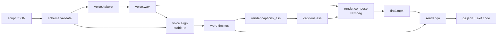

# Shorts Pipeline: Architecture

The full system diagram (Workflows A, B, C) is in PLAN.md section 2. This file covers how the code is put together, starting with Phase 1. The build harness is described in HARNESS.md.

## 1. Shape of the system (Phase 1)

Everything runs in one GitHub Actions job (`.github/workflows/render.yml`), started by hand. `pipeline/render_one.py` wires the steps; each step is a module with no knowledge of the others.

## 2. Layers and boundaries

| Layer | Files | Owns | Must not |
|---|---|---|---|
| Contracts | `schema.py`, `constants.py` | Data shapes and every number from spec.md section 4 | Import other pipeline code; do IO |
| Adapters | `voice/*.py`, `render/*.py` | One external tool each (Kokoro, stable-ts, FFmpeg) | Import each other; hardcode numbers |
| Wiring | `render_one.py` | Order of steps, file names in `out_dir`, exit code | Contain logic that belongs in a module |
| Runner | `.github/workflows/*.yml` | Install, cache, run, upload artifact | Contain pipeline logic |

Imports only point upward in that table: wiring imports adapters and contracts, adapters import contracts.

## 3. Key flows

**Render one script.** Validate the JSON, synthesise voice, align the known text, build captions, compose, run QA, write `qa.json`, exit 0 only on QA pass.

**Voice failure.** Kokoro raises, the run stops with a non-zero exit and the reason. No retry, since a local model fails the same way twice. Phase 4 adds the alert.

**QA failure.** The MP4 is still written and uploaded as an artifact for debugging, `qa.json` lists each failed check, and the exit code is non-zero. Phase 4 turns this into "skip, alert, try the next script".

## 4. Decisions and reasons

- **Forced alignment, not transcription.** The words come from the script, so captions can never misspell. Rejected: Whisper transcription, which invents spellings.
- **Solid background in Phase 1.** Proves the render path without the template router. Rejected: building a placeholder router now (YAGNI, Phase 3 owns it).
- **Contracts in two locked files plus signature stubs.** Implementers can't change shapes or numbers to make tests pass, and the locked tests pin each module's signatures. Rejected: Protocols, since each step has one implementation.
- **Kokoro only.** One CPU voice with pinned weights, no unofficial endpoint. Rejected: edge-tts with Kokoro fallback (owner decision 2026-11-15).
- **Task-aware conftest.** Locked tests for unbuilt tasks are skipped until the task is in `.harness/status.yaml`, so main and CI stay green. Rejected: gate commands that list test files per task, which every runner would have to repeat.
- **FFmpeg via argument lists.** No shell, so no injection through titles or paths. Rejected: shell command strings.
- **Current task from `LOOM_TASK` env var.** Set at launch, so the agent can't rewrite it from inside the session. Rejected: a `.harness/current_task` file.

## 5. Error handling

- Adapters raise specific exceptions with the tool's stderr tail. They never return an empty file as success.
- Only `render_one.py` catches exceptions, and only to turn them into an exit code with a message.
- QA problems are data (a failed `QAReport`), not exceptions.
- Nothing is swallowed. Every caught error is logged with its cause.

## 6. Testing map

| Layer | Test kind | Purpose |
|---|---|---|
| Contracts | Unit | Schema accepts the sample, rejects bad fields |
| Adapters | Unit with fakes or fixtures | Argument building, escaping, edge cases, error paths |
| Adapters | `heavy` integration (ffmpeg, torch) | The real tool on the committed fixture wav |
| Wiring | `heavy` acceptance | Sample script to a QA-passing `final.mp4` |
| Render output | Golden render (`heavy`) plus visual-qa review of extracted frames | The video is the frontend: readability, safe zones, glitches |
| Captions | hypothesis property tests | Timing invariants hold for any word list, not just examples |
| Whole codebase | bandit, semgrep, gitleaks, pip-audit, actionlint in CI | Security basics on every task, free |
| Test suite | mutmut at phase end, read by the QA Lead | Shows which bugs the tests would miss |
| Runner | Structure test plus manual run | Workflow shape; owner judges the artifact |
| Harness | `.harness/tests/` | Lock hook and outcome logger |

All task tests are written and locked by p1-contracts before implementation.

## 7. Known weak points

- The lock hook only watches Edit, Write, MultiEdit and NotebookEdit. A Bash command can still write a file. The control that holds is CI's scope check on `task/<id>` branches (diff against `paths_allowed`, `locks.yaml` and the admin files), added by p1-contracts. Until then it is a manual Gate 1 check.
- The hook matches globs with `fnmatch`, where `*` also crosses `/`. Patterns are slightly more permissive than they look.
- The hook blocks Windows aliasing forms (UNC and device paths in any slash mix, 8.3 names, trailing dots or spaces, `:` streams) and resolves symlinks and junctions. A legitimate file name containing `~` is blocked too; rename it.
- Claude Code files that run code or change configuration (hooks, settings, agents, commands, skills, plugins, `.claude.json`, `.mcp.json`, managed settings), anywhere on disk, need a session launched with `LOOM_ADMIN=1`. That includes retrospective sessions that add skills.
- Outside the repo, planning sessions may only write Claude's memory (`~/.claude/projects/*/memory/`) and job scratch (`~/.claude/jobs/*/tmp/`); tasks may not write outside at all. A new legitimate outside location needs an `OUTSIDE_ALLOWED` entry.
- The hook is a best-effort local guard. Bash, and anything not routed through the edit tools, bypasses it. The CI scope check and PR review are the controls that hold. The private repo on a free plan has no branch protection, so nothing server-side stops a direct push to `main`; the owner reviews every PR diff.
- If `python` itself is missing from PATH, the hook cannot start and Claude Code allows the edit. A missing PyYAML is handled: the hook blocks.
- A new or changed `.claude/settings.json` is picked up only at session start (or after opening `/hooks`).
- Stage 0 relies on the owner launching each implementer with `LOOM_TASK` set. Without it, only locks are enforced, not `paths_allowed`.
- Kokoro is the only voice. If it breaks, nothing renders until it's fixed.
- Heavy tests run only in CI, so every fix round on a heavy task waits for a CI run.
- The task-aware conftest trusts `.harness/status.yaml`. Marking a task done by mistake turns on tests that may fail on main.
- torch makes the install heavy. Without caching, a run may exceed the 15-minute target.
- FFmpeg's `subtitles=` filter path escaping differs between Windows and Linux.
- Outcome records are logged by hand in Stage 0, so they can be missed.
