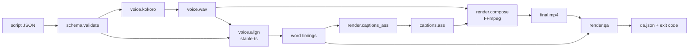
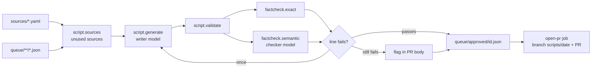

# Shorts Pipeline: Architecture

The full system diagram (Workflows A, B, C) is in PLAN.md section 2. This file covers how the code is put together, starting with Phase 1. The build harness is described in HARNESS.md.

## 1. Shape of the system (Phase 1)

Everything runs in one GitHub Actions job (`.github/workflows/render.yml`), started by hand. `pipeline/render_one.py` wires the steps; each step is a module with no knowledge of the others. Before the voice step it runs `script.validate.problems` and exits 2 with the messages if the script is not publishable, so a bad script never costs a render. The golden frames (every 10 s from 1 s to 60 s plus one 0.5 s before the end) come from `tests/media.py::extract_golden_frames`, used by both render.yml and the heavy test; they are for visual review, not pixel comparison.

## 1a. Workflow A (Phase 2)

`.github/workflows/weekly_scripts.yml` has three jobs. `generate` holds the Gemini key and a read-only token, installs only hash-checked packages, runs `python -m pipeline.script.batch` and uploads the scripts and `pr_body.md` as an artifact. `validate` holds no secret, copies only the new script files from the artifact (extracted to the runner temp folder, never over the checkout) and runs `tests/test_queue_scripts.py`. `open-pr` holds no secret, gets `contents` and `pull-requests` write, commits the copied scripts to a `scripts/<date>` branch and opens the PR; it needs `validate`. Merging that PR is the approval. `script/gemini.py` is the only module that talks to Gemini; every other step reaches it through the module, so tests replace it with a fake.

## 2. Layers and boundaries

| Layer | Files | Owns | Must not |
|---|---|---|---|
| Contracts | `schema.py`, `constants.py` | Data shapes and every number from spec.md section 4 | Import other pipeline code; do IO |
| Adapters | `voice/*.py`, `render/*.py`, `script/gemini.py` | One external tool each (Kokoro, stable-ts, FFmpeg, Gemini) | Import each other; hardcode numbers |
| Domain | `factcheck/*.py`, `script/validate.py`, `script/sources.py`, `script/generate.py` | Fact-check rules, publishable-field rules, prompts, source selection | Do network IO except through `script/gemini.py` |
| Wiring | `render_one.py`, `script/batch.py` | Order of steps, file names, flags, exit code | Contain logic that belongs in a module |
| Runner | `.github/workflows/*.yml` | Install, cache, run, upload artifact | Contain pipeline logic |

Imports only point upward in that table: wiring imports adapters and contracts, adapters import contracts.

## 3. Key flows

**Render one script.** Validate the JSON, synthesise voice, align the known text, build captions, compose, run QA, write `qa.json`, exit 0 only on QA pass.

**Voice failure.** Kokoro raises, the run stops with a non-zero exit and the reason. No retry, since a local model fails the same way twice. Phase 4 adds the alert.

**QA failure.** The MP4 is still written and uploaded as an artifact for debugging, `qa.json` lists each failed check, and the exit code is non-zero. Phase 4 turns this into "skip, alert, try the next script".

## 4. Decisions and reasons

- **Forced alignment, not transcription.** The words come from the script, so captions can never misspell. Rejected: Whisper transcription, which invents spellings.
- **Solid background in Phase 1.** Proves the render path without the template router. Rejected: building a placeholder router now (YAGNI, Phase 3 owns it).
- **Contracts in two locked files plus signature stubs.** Implementers can't change shapes or numbers to make tests pass, and the locked tests pin each module's signatures. Rejected: Protocols, since each step has one implementation.
- **Kokoro only.** One CPU voice with pinned weights, no unofficial endpoint. Rejected: edge-tts with Kokoro fallback (owner decision 2026-11-15).
- **PyTorch `kokoro` package with misaki, weights pinned by revision and sha256.** Best pronunciation for English names and numbers, which the owner's quality bar requires. Rejected: `kokoro-onnx`, lighter but likely relies on a more generic pronunciation engine; reconsidered only after a side-by-side listen. Caption timing does not depend on this choice, since captions come from forced alignment on the actual audio.
- **Orchestrated Stage 0.** An orchestrating Claude session launches each task as a fresh session with `LOOM_TASK` set, in a visible PowerShell window that closes when the session exits, then verifies the gates itself, runs read-only reviewer sessions and opens the PR. Rejected: the owner launching sessions by hand (the owner wants hands-off) and building Loom early (HARNESS.md stages it for Phase 2, after Stage 0 evidence).
- **Docs kept in sync by the harness.** Every handoff lists its doc changes, the reviewer blocks on docs the diff makes false, a Haiku Scribe applies the mechanical updates at each task close-out, and `tests/docs_check.py` fails CI when status, task ids or the criterion map disagree. Rejected: a `/loop` (dies with the session) and a scheduled cloud agent (spends usage on every run).
- **Task-aware conftest.** Locked tests for unbuilt tasks are skipped until the task is in `.harness/status.yaml`, so main and CI stay green. Rejected: gate commands that list test files per task, which every runner would have to repeat.
- **FFmpeg via argument lists.** No shell, so no injection through titles or paths. Rejected: shell command strings.
- **Phase 2: merge is approval** (proposed, owner decision D2). Workflow A writes scripts straight into `queue/approved/` on its PR branch. Rejected: `queue/pending/` plus an `on_merge_approve.yml` move, which adds a workflow with write access for no extra safety.
- **Phase 2: the queue is the ledger** (proposed, D3). A source counts as used when any of its fact ids appears in a script under `queue/`. Rejected: `data/used_facts.json`, written on a PR branch by Workflow A and on main by Workflow B, so a week-old PR would conflict.
- **Phase 2: hand-curated sources only** (proposed, D4). Rejected for now: RSS and news ingest, which adds untrusted internet text (prompt injection) and stale news to an evergreen niche.
- **Phase 2: Gemini over the standard library.** One small `urllib` client. Rejected: the Google SDK, a new dependency for one POST.
- **Phase 2: two jobs in Workflow A.** The Gemini key and the write token never share a job (CSO P1-6). Rejected: one job with both.
- **Current task from `LOOM_TASK` env var.** Set at launch, so the agent can't rewrite it from inside the session. Rejected: a `.harness/current_task` file.

## 5. Error handling

- Adapters raise specific exceptions with the tool's stderr tail. They never return an empty file as success.
- Adapters catch only their tool's own errors (subprocess, HTTP, model load) and re-raise them as their specific exception. Only the wiring (`render_one.py`, `script/batch.py`) catches those, `render_one.py` to turn them into an exit code with a message, `batch.py` to leave one script out and list it in the PR body.
- Fact-check results are data (verdicts and flags), never exceptions. Workflow A never stops on one; it stops only when no script could be written.
- QA problems are data (a failed `QAReport`), not exceptions.
- Nothing is swallowed. Every caught error is logged with its cause.

## 6. Testing map

| Layer | Test kind | Purpose |
|---|---|---|
| Contracts | Unit | Schema accepts the sample, rejects bad fields |
| Adapters | Unit with fakes or fixtures | Argument building, escaping, edge cases, error paths |
| Adapters | `heavy` integration (ffmpeg, torch) | The real tool on the committed fixture wav |
| Wiring | `heavy` acceptance | Sample script to a QA-passing `final.mp4` |
| Render output | Golden render (`heavy`) plus visual-qa review of extracted frames | The video is the frontend: readability, safe zones, glitches |
| Captions | hypothesis property tests | Timing invariants hold for any word list, not just examples |
| Whole codebase | bandit, semgrep, gitleaks, pip-audit, actionlint in CI | Security basics on every task, free |
| Test suite | mutmut at phase end, read by the QA Lead | Shows which bugs the tests would miss |
| Runner | Structure test plus manual run | Workflow shape; owner judges the artifact |
| Harness | `.harness/tests/` | Lock hook and outcome logger |
| Fact-check (Phase 2) | Unit plus hypothesis, with an independent number-to-words oracle | Every standard form of a number agrees |
| Gemini callers (Phase 2) | Unit with a fake `gemini.generate_json` or a fake `OpenerDirector.open`; redirects against two local HTTP servers | Prompts, retries, budgets, key never logged; no network in tests |
| Workflows | One safety test over every file in `.github/workflows/` (Phase 2) | Pinned actions, no `pull_request_target`, write permissions and secrets only where allowlisted |

Phase 1 task tests were written and locked by p1-contracts before implementation. Phase 2 tests come from the Architect (p2-factcheck-exact, on the plan branch) and p2-contracts.

## 7. Known weak points

Threat model and open security items: `docs/threat-model.md`.

- The lock hook only watches Edit, Write, MultiEdit and NotebookEdit. A Bash command can still write a file. The control that holds is CI's scope check on `task/<id>` branches (diff against `paths_allowed`, `locks.yaml` and the admin files), added by p1-contracts.
- The hook matches globs with `fnmatch`, where `*` also crosses `/`. Patterns are slightly more permissive than they look.
- The hook blocks Windows aliasing forms (UNC and device paths in any slash mix, 8.3 names, trailing dots or spaces, `:` streams) and resolves symlinks and junctions. A legitimate file name containing `~` is blocked too; rename it.
- Claude Code files that run code or change configuration (hooks, settings, agents, commands, skills, plugins, `.claude.json`, `.mcp.json`, managed settings), anywhere on disk, need a session launched with `LOOM_ADMIN=1`. That includes retrospective sessions that add skills.
- Outside the repo, planning sessions may only write Claude's memory (`~/.claude/projects/*/memory/`) and job scratch (`~/.claude/jobs/*/tmp/`); tasks may not write outside at all. A new legitimate outside location needs an `OUTSIDE_ALLOWED` entry.
- The hook is a best-effort local guard. Bash, and anything not routed through the edit tools, bypasses it. The CI scope check and PR review are the controls that hold. The private repo on a free plan has no branch protection, so nothing server-side stops a direct push to `main`; the owner reviews every PR diff.
- If `python` itself is missing from PATH, the hook cannot start and Claude Code allows the edit. A missing PyYAML is handled: the hook blocks.
- A new or changed `.claude/settings.json` is picked up only at session start (or after opening `/hooks`).
- Stage 0 relies on the owner launching each implementer with `LOOM_TASK` set. Without it, only locks are enforced, not `paths_allowed`.
- Kokoro is the only voice. If it breaks, nothing renders until it's fixed.
- Heavy tests run only in CI, so every fix round on a heavy task waits for a CI run.
- The task-aware conftest trusts `.harness/status.yaml`. Marking a task done by mistake turns on tests that may fail on main.
- torch makes the install heavy. Without caching, a run may exceed the 15-minute target.
- The compose, qa, Kokoro and align heavy-only paths now have fast fake-based tests (p1-qa-tests). The ffprobe, silencedetect and loudnorm fakes use real FFmpeg output in `tests/fixtures/ffmpeg/`; the heavy guard `tests/render/test_ffmpeg_fixtures.py` flags drift when FFmpeg changes.
- FFmpeg's `subtitles=` filter path escaping differs between Windows and Linux.
- Outcome records are logged by hand in Stage 0, so they can be missed.
- Phase 2: repo secrets reach a workflow on any pushed branch, and GitHub Free gives private repos no environment secrets or branch rules (CSO P1-1, PRD.md section 7). The Gemini key's damage is capped at its free quota, so D1 took option (c): the key is a repo secret (2026-11-18). Publishing tokens in Phase 4 need a stronger answer.
- Phase 2: p2-weekly-hardening (CSO P2-1, P2-2, P2-4, P2-6) is merged: the key job installs hash-checked packages only, `open-pr` adds only new id-named script files, the `validate` job re-runs the queue tests before the PR opens, and runs never overlap. Workflow A stays disabled until the owner's first manual run.
- Phase 2: the URL check fails closed on legitimate text. The bare-domain rule rejects file names ("report.pdf"), "Amazon.com" and "Node.js". Unassigned code points (Cn) are rejected too, so an emoji newer than the runtime's Unicode tables is refused with the "control or invisible character" message (Python 3.11 locally is Unicode 14.0, 3.12 in CI is 15.0). Such a script is regenerated or edited, never published with a link.
- Phase 2: the exact check reads proper nouns from capital letters, so a name at the start of a sentence is not checked, and number words below ten are ignored. Both miss rather than false-flag; the meaning check and the owner's review cover the rest.
- Phase 2: the scripts PR opened with `GITHUB_TOKEN` starts no CI run; the batch validates before opening it, and the owner's edit commits do run CI.
- Phase 2: only scene narration is fact-checked. The hook and loop line are spoken but neither layer sees them, and title and description are not checked, so a made-up number there gets no flag. The owner reads the PR, but this needs a contract change before Phase 4 (phase review N1).
- Phase 2: the exact layer reads only ASCII digits (`normalise.py`), so full-width and Arabic-Indic digits skip it. Spelled ordinals ("fifteenth") and a lone zero to nine ("seven seconds") are never checked by the exact layer; only the meaning layer catches them (phase review N2, QA lead).
- Phase 2: sources run out. 14 seeded sources last two weekly batches; after that the batch writes fewer scripts ("N of 7: sources exhausted") and then fails with no PR. A refill plan (another research session, or the owner, optionally helped by NotebookLM by hand) is needed before Phase 4 goes live.
- Phase 2: Gemini model ids retire (for example `gemini-3.1-flash-lite` on 2027-05-07). A retired id gives HTTP 404 and the batch fails loudly, but someone should check the Gemini deprecations page every few months and update `constants.py`. `generation_config.temperature` is documented only in the overview, so the first live run confirms it.
- Phase 2: the batch reserves the worst case for scripts still to come (`SCRIPT_ATTEMPTS` writer calls and one checker call each), so early rewrites are more conservative than the totals need. The caps count logical calls; with the client's one retry a call can be two HTTP requests, so real requests can reach twice the cap.
- Phase 4 gap: upload, then commit. If a publish run uploads a video and dies before committing, the next run uploads it again. Workflow B must commit the platform video id and the move to `queue/published/` right after each upload, and skip any script that already has a video id.
- Workflow safety rules (`tests/workflow_rules.py`, p2-entry-ci reviewer notes, non-blocking): the `actions/checkout@` match is case-sensitive (`tests/workflow_rules.py:83`), so a differently cased `uses:` would skip the persist-credentials rule (GitHub resolves action names case-insensitively); local `./` actions are not checked; the bare word "secrets" anywhere (even a step name) fails closed; `shell:` and `defaults.run` are not checked; and `tests/docs_check.py`'s task-id matching (`TASK_ID`) leaves a loophole for rows that avoid naming a task id.
